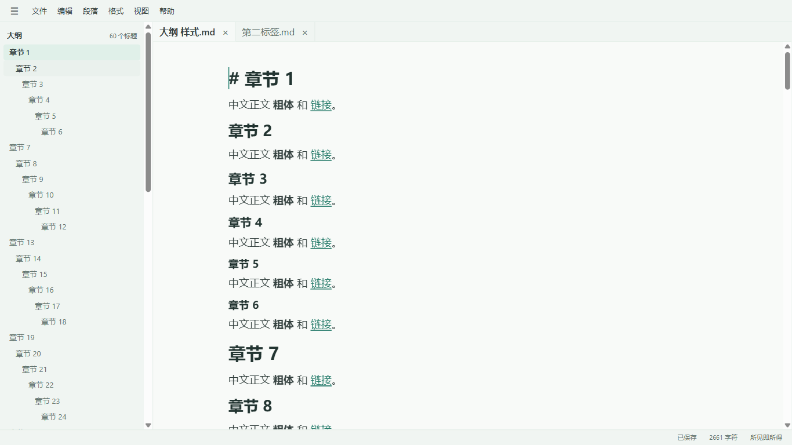
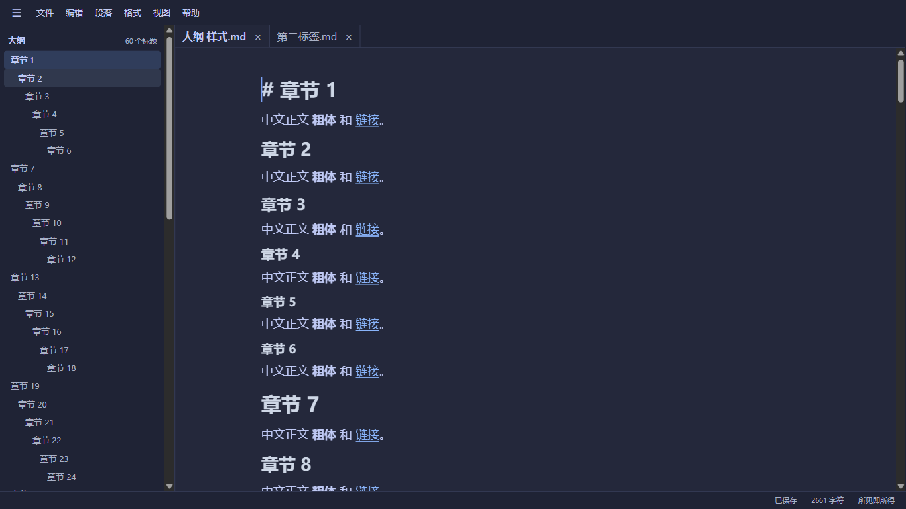

# Mintdown

简洁、离线运行的 Windows Markdown 桌面编辑器。

**[下载 Mintdown v0.4.1 预览版](https://github.com/Mintind/mintdown/releases/tag/v0.4.1)** · Windows x64 · NSIS 安装程序

## 功能

- 所见即所得与完整源码模式，光标进入格式时可编辑局部 Markdown 源码。
- 多标签文档、大纲导航、查找替换、会话恢复与独立恢复快照。
- GFM 表格、代码高亮、数学公式、直接编辑的 YAML Front Matter。
- 本地图片插入归档、缺失图片重新定位、文档与资源联动。
- 独立 HTML 与可选择文字的 PDF 导出，PDF 包含标题书签。
- Mint Light / Tokyo Night 两套主题，以及标准 / 紧凑界面密度。

## 截图

以下使用合成示例文档，不包含个人文章。

## 安装与使用

1. 从版本页面下载 `Mintdown_0.4.1_x64-setup.exe` 和 `SHA256SUMS.txt`。
2. 在 PowerShell 中运行 `Get-FileHash .\Mintdown_0.4.1_x64-setup.exe -Algorithm SHA256`，与清单核对。
3. 运行安装向导，选择当前用户的安装目录。安装后的应用不需要 Node.js、Rust 或开发工具。
4. 通过开始菜单启动 Mintdown，打开 Markdown 文件。`.md` 默认编辑器由用户在 Windows 中自行选择，安装器不强行接管。

需要 Microsoft Edge WebView2 运行时；安装程序包含微软引导程序，系统缺少运行时时可能需要联网下载。日常编辑不需要本地开发服务器或账户。

## 预览版状态

本版本**未进行代码签名**，Windows 可能显示发布者未知提示；请先核对下载来源和 SHA-256。隔离 Windows 用户下的完整安装、升级、卸载、缺少 WebView2 时的首次安装及 Explorer 连续双击等安装验收尚未全部完成。请备份重要文档后试用。实际构建和测试范围见[版本说明](releases/v0.4.1.md)。

## 本仓库的范围

本仓库仅用于发布指定版本的安装程序、说明、截图及必要第三方合规材料，**不包含 Mintdown 的应用开发源码或开发历史，不是 Mintdown 源码开源仓库**。GitHub 自动生成的 Source code 归档也仅包含这些公开资料。

第三方版权与许可见 [THIRD_PARTY_NOTICES.txt](third-party/THIRD_PARTY_NOTICES.txt) 和 [COMPONENTS.json](third-party/COMPONENTS.json)。`third-party/sources/` 仅含许可证要求提供的、未修改的 MPL-2.0 第三方组件原始源码包，不含 Mintdown 应用源码。这些组件继续遵循各自许可证。

后续版本仅在维护者明确决定发布时更新，不随本地日常开发提交自动发布。
